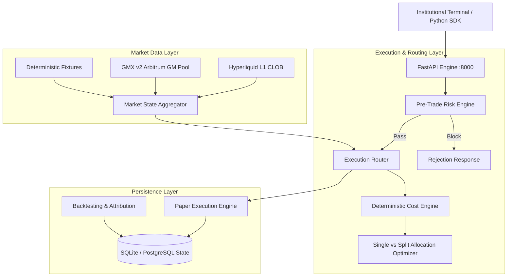

# ORION — On-chain Routing & Intelligence for Optimal Notional Execution

[](https://github.com/aryanp160/orion/actions/workflows/ci.yml)
[](https://www.python.org/downloads/)
[](https://nextjs.org/)
[](LICENSE)

ORION is an institutional execution-intelligence and smart order routing platform for Ethereum-related perpetual futures markets.

Its primary purpose is to answer:
> *"For this proposed order, which supported venue and execution strategy offer the best estimated total execution outcome, considering market impact, fees, funding, latency, liquidity, and risk?"*

---

## 1. System Architecture



---

## 2. Supported Venues & Networks

| Venue | Network Scope | Execution Mechanism | Status | Real Data Endpoint |
|---|---|---|---|---|
| **Hyperliquid (`HYPERLIQUID`)** | Hyperliquid L1 (custom appchain) | High-speed CLOB | **Verified Live Public Data** | `POST https://api.hyperliquid.xyz/info` |
| **GMX v2 (`GMX_V2`)** | Arbitrum One (Ethereum Layer 2) | GM Oracle Liquidity Pools | **Verified Live Public Data** | `GET https://arbitrum-api.gmxinfra.io/prices/tickers` |
| **Deterministic Fixture (`MOCK_CLOB`)** | Offline Simulation | Deterministic seeded order book | **Verified Offline Fixture** | In-memory local fixture |

---

## 3. Features Implemented vs. Planned

| Feature Area | Implemented & Verified | Planned / Next Phase |
|---|---|---|
| **Market Ingestion** | Real REST polling for Hyperliquid L1 & GMX v2 Arbitrum, L2 depth normalization, basis calculation, staleness tracking | Persistent low-latency WebSocket connection manager |
| **Cost Engine** | Deterministic arrival-price shortfall, top-of-book spread, depth VWAP walking, maker/taker fees, funding horizon scaling, L2 gas fees | Cross-currency margin collateral haircut modeling |
| **Router** | Candidate ranking, hard eligibility filters (max slippage, min size, freshness), bounded split optimizer, structured explainability ledger | Multi-leg cross-margin basis arbitrage routes |
| **Risk Engine** | Max order notional ($250k), position exposure ($1M), slippage collars, 120s duplicate idempotency, fail-closed staleness, emergency kill switch | Portfolio VaR (Value at Risk) stress tester |
| **Paper Trading** | Persistent order lifecycle, depth fill walking, realized/unrealized PnL accounting, margin tracking, cancellation, reset | Simulated passive limit order queue priority model |
| **Backtesting** | Point-in-time sequential replay, look-ahead bias prevention, Naive Baseline vs Best Single vs ORION comparisons, P50/P90/P99 distributions | Multi-month parquet historical replay |
| **Frontend Terminal** | Dark institutional trading terminal, real-time depth book, execution workbench, route comparisons, paper account management, backtesting launcher | Interactive TradingView lightweight charts |

---

## 4. Requirements & Prerequisites

- **Python**: `>= 3.12.0`
- **Node.js**: `>= 20.0.0` (Node 22 recommended)
- **Package Managers**: `pip`, `npm`
- **Database**: SQLite (default zero-config local development) or PostgreSQL 16+

---

## 5. Quickstart: The First Command to Run

To launch the complete ORION application locally:

### Option A: Standard Startup

```bash
# 1. Start the FastAPI Backend (Terminal 1)
python -m uvicorn apps.api.main:app --host 127.0.0.1 --port 8000 --reload

# 2. Start the Quantitative Terminal Frontend (Terminal 2)
cd apps/web && npm run dev
```

Then open your browser to **[http://localhost:3000](http://localhost:3000)**.  
The FastAPI OpenAPI documentation is available at **[http://127.0.0.1:8000/docs](http://127.0.0.1:8000/docs)**.

---

## 6. Makefile & CLI Commands

| Command | Action |
|---|---|
| `make install` | Install all backend and frontend dependencies |
| `make test` | Run complete Pytest test suite (unit, integration, contract) |
| `make lint` | Run Ruff linter across the codebase |
| `make typecheck` | Run Mypy static type checker |
| `make migrate` | Apply Alembic database migrations |
| `make paper-demo` | Run the standalone paper execution simulation script |
| `make backtest-demo` | Run the standalone historical attribution replay script |
| `make docker-up` | Build and start containers via Docker Compose |

---

## 7. Verification & Testing

To run the automated verification suite:

```bash
# Run all unit, integration, and contract tests
pytest tests -v

# Run linter
ruff check .

# Run type checker
mypy apps/ services/ packages/ --explicit-package-bases --ignore-missing-imports

# Run production frontend build
cd apps/web && npm run build
```

---

## 8. Safety & Operational Policies

1. **Strict Fail-Safe Paper Default**:
   `ORION_EXECUTION_MODE=paper` is strictly hardcoded as the default. Live execution is disabled by default and requires explicit environment variable opt-in plus valid API credentials without withdrawal permissions.
2. **Deterministic Data Integrity**:
   ORION never fabricates or invents market prices. When an external venue API is unreachable, it honestly reports degraded availability and prevents execution against stale feeds.
3. **No Committed Secrets**:
   All configurations use `.env.example`. No private keys or funded wallet secrets are stored in the repository.
