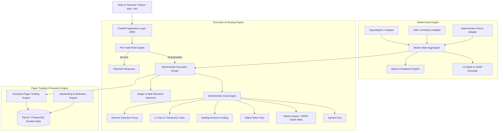

# ORION System Architecture & Execution Intelligence Design

## Core Subsystems

1. **Market Data Ingestion Engine**:
   - Queries real public endpoints on Hyperliquid L1 (`https://api.hyperliquid.xyz/info`) and GMX v2 Arbitrum (`https://arbitrum-api.gmxinfra.io/prices/tickers`).
   - Normalizes heterogenous venue models into unified domain models (`OrderBook`, `MarkPrice`, `FundingObservation`).
   - Tracks data freshness, feed latency, and sequence gaps with strict fail-closed degradation.

2. **Deterministic Execution Cost Engine**:
   - Reference Price: Arrival Mid-Price $P_{\text{mid}} = (P_{\text{bid0}} + P_{\text{ask0}}) / 2$.
   - Cost Breakdown: Total Cost = Spread Cost + Depth Impact + Fees + Funding + Gas + Adverse Selection.
   - Strictly prevents double-counting between top-of-book spread and depth impact.

3. **Execution Router**:
   - Evaluates all eligible candidate routes.
   - Evaluates multi-venue split allocations when order notional is substantial, balancing impact reduction against transaction overhead.
   - Produces explainable rejection reasons for all unchosen alternatives.

4. **Pre-Trade Risk Engine**:
   - Enforces notional caps ($250k), position exposure limits ($1M), concurrent order limits (10), slippage collars, stale data blocks, and emergency kill switches.

5. **Persistent Paper Trading & Backtesting**:
   - Realistic fill simulation against real depth with maker/taker fee accounting.
   - Point-in-time sequential replay for execution alpha attribution without look-ahead bias.
